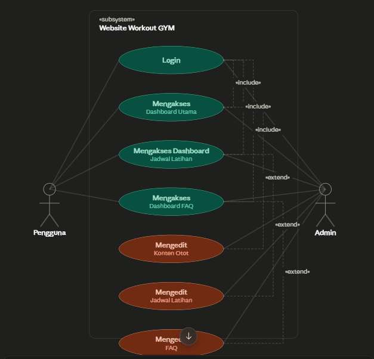

<div class="cover">

<p class="cover-kicker">BUSINESS REQUIREMENT DOCUMENT (BRD)</p>

<p class="cover-title">Aplikasi Mobile Workout GYM untuk Pemula</p>

<p class="cover-sub">Sistem Tutorial Workout untuk Pemula di GYM Berbasis Mobile (Flutter)</p>

<table class="cover-meta">
<tr><td>Versi Dokumen</td><td>1.0</td></tr>
<tr><td>Status</td><td>Final &mdash; Project Akhir Kuliah</td></tr>
<tr><td>Tanggal</td><td>25 Oktober 2026</td></tr>
<tr><td>Disusun oleh</td><td>Muhammad Aditya (20240801234)</td></tr>
<tr><td>Mata Kuliah</td><td>Pemrograman Mobile</td></tr>
<tr><td>Platform</td><td>Android (utama), iOS</td></tr>
<tr><td>Dokumen Acuan</td><td>Business Requirement Document &mdash; Website Workout GYM untuk Pemula</td></tr>
<tr><td>Ruang Lingkup</td><td>Aplikasi mobile untuk Pengguna; dashboard Admin tetap berbasis web</td></tr>
</table>

<p class="cover-note">Dokumen ini merupakan versi mobile dari BRD Website Workout GYM untuk Pemula dan mengikuti struktur bab yang sama (1&ndash;15). Seluruh konten, data, dan use case mengacu pada platform web yang sudah ada; aplikasi mobile berperan sebagai kanal akses kedua yang mengonsumsi REST API Laravel.</p>

</div>

## Riwayat Revisi

| Versi | Tanggal | Perubahan | Penyusun |
|---|---|---|---|
| 1.0 | 25 Oktober 2026 | Dokumen awal BRD versi mobile: penyesuaian ruang lingkup, penambahan persyaratan fungsional mobile, kontrak integrasi API, penyesuaian model data, dan kriteria penerimaan mobile. | Muhammad Aditya |

## 1. Ringkasan Eksekutif

Dokumen Business Requirement Document (BRD) ini menjelaskan kebutuhan bisnis dan kebutuhan sistem untuk pengembangan **Aplikasi Mobile Tutorial Workout GYM untuk Pemula**, yaitu aplikasi Android dan iOS berbasis Flutter yang membantu pemula mempelajari gerakan latihan kebugaran secara mandiri. Aplikasi mobile mengonsumsi data dari REST API platform **Website Simple Workout** yang telah lebih dahulu dibangun, sehingga konten otot, gerakan, video, deskripsi, template jadwal, FAQ, dan pengaturan situs tetap dikelola oleh Admin melalui dashboard CMS berbasis web.

Aplikasi ini dirancang untuk mempermudah pengguna *trainee* dalam mengakses materi gerakan berdasarkan bagian otot yang ingin dilatih, menonton video tutorial dari YouTube yang telah dikurasi, membaca deskripsi gerakan yang jelas dan aman, mengikuti template jadwal latihan mingguan, serta menandai checklist latihan sebagai catatan pribadi. Materi yang sudah pernah dibuka dan checklist disimpan di perangkat sehingga tetap dapat dibaca ketika koneksi internet di area latihan sedang tidak stabil, lalu disinkronkan kembali ke server ketika koneksi tersedia.

Aplikasi mobile **tidak menggantikan** platform web, melainkan menjadi kanal akses kedua yang lebih praktis digunakan saat pengguna berada di gym. Pengelolaan konten, moderasi saran/kritik, integrasi Pexels API, dan pengaturan website tetap dilakukan Admin melalui dashboard web. Dengan demikian, satu sumber data melayani dua kanal: web untuk pengelolaan dan penjelajahan desktop, mobile untuk penggunaan cepat di lapangan.

## 2. Latar Belakang dan Justifikasi Bisnis

### 2.1 Konteks

Website Tutorial Workout GYM untuk Pemula merupakan platform jasa bimbingan kebugaran digital yang melayani kebutuhan pemula dalam mempelajari gerakan dasar gym seperti Squat, Bench Press, Deadlift, dan gerakan otot lainnya. Platform web tersebut sudah menyediakan peta tubuh, daftar gerakan, video YouTube terkurasi, deskripsi *step-by-step*, daftar kesalahan umum, template jadwal latihan, serta halaman FAQ dan formulir saran/kritik.

Kebutuhan akses yang sebenarnya muncul di lokasi latihan: pengguna berdiri di depan alat gym, memegang telepon dengan satu tangan, memiliki waktu istirahat antar set yang singkat, dan sering berada di ruang dengan koneksi internet yang lemah. Pada kondisi tersebut, membuka browser, mengetik alamat situs, menunggu halaman dimuat ulang, lalu menggulir halaman web terasa lambat dan mengganggu ritme latihan. Karena itu diperlukan aplikasi mobile yang menyajikan konten yang sama dengan navigasi yang dirancang khusus untuk layar kecil dan pemakaian satu tangan.

### 2.2 Permasalahan

1. Pengguna harus membuka browser dan mengetik alamat situs setiap kali akan melihat panduan gerakan di gym.
2. Sesi login pada browser mudah hilang sehingga pengguna harus masuk berulang kali di tengah latihan.
3. Materi gerakan dan checklist tidak dapat diakses ketika koneksi internet di area latihan buruk atau terputus.
4. Checklist jadwal sulit dijangkau dengan cepat karena harus menggulir halaman web yang panjang.
5. Pengingat latihan hanya dikirim melalui email, sehingga kurang terasa saat pengguna tidak membuka email.
6. Pemutaran video YouTube yang tertanam di browser terhenti ketika pengguna berpindah tab untuk membuka aplikasi lain.
7. Tata letak web yang dirancang untuk desktop dan dua tangan kurang nyaman digunakan sambil memegang peralatan gym.

### 2.3 Solusi yang Diusulkan

Membangun aplikasi mobile Flutter yang mengonsumsi REST API platform web yang sudah ada, dengan fitur:

- Registrasi, login, logout, dan lupa password.
- Beranda dengan sapaan personal, statistik konten, dan akses cepat ke peta tubuh.
- Peta Tubuh / daftar nama otot untuk memilih otot yang ingin dilatih.
- Daftar gerakan spesifik untuk setiap otot, dengan filter tipe latihan Gym/Home.
- Halaman detail gerakan yang berisi video YouTube tertanam, deskripsi *step-by-step*, dan daftar kesalahan umum.
- Navigasi bebas antar otot dan antar gerakan tanpa batasan urutan.
- Daftar template jadwal latihan mingguan beserta tabel hari Senin&ndash;Minggu.
- Pendaftaran langganan template jadwal melalui tombol **Mulai Jadwal**.
- Checklist harian yang tersimpan per akun, dapat dipakai saat offline, dan disinkronkan otomatis.
- Halaman FAQ & Kirim Saran terpadu dengan akordeon, pencarian, dan formulir berkategori.
- Halaman profil, kontak Admin, dan hapus akun.

Manfaat yang diharapkan:

- Mempermudah pemula mempelajari gerakan gym sesuai otot yang ingin difokuskan, langsung dari perangkat yang dibawa ke gym.
- Mengurangi risiko cedera karena gerakan disertai deskripsi langkah dan kesalahan umum.
- Memberikan kebebasan belajar non-linear sehingga pengguna tidak bosan.
- Menyediakan saluran saran/kritik yang mudah diakses dari perangkat mobile.
- Menjaga kontinuitas belajar ketika koneksi internet tidak stabil melalui penyimpanan lokal.
- Memanfaatkan kembali data dan API platform web tanpa duplikasi pengelolaan konten.

## 3. Tujuan Bisnis

1. Menyediakan kanal belajar gerakan gym yang fleksibel, cepat, dan mudah digunakan bagi pemula melalui aplikasi mobile.
2. Membantu pengguna memahami teknik gerakan dengan benar melalui kombinasi video kurasi YouTube dan deskripsi tertulis *step-by-step* beserta kesalahan umum.
3. Mempermudah pengguna memilih materi latihan berdasarkan bagian otot yang ingin difokuskan.
4. Menyediakan template jadwal latihan mingguan sebagai panduan bagi pengguna yang ingin latihan terstruktur.
5. Memungkinkan pengguna mencatat progres latihan harian melalui checklist pribadi yang tersimpan per akun.
6. Menjaga pengalaman belajar tetap berjalan pada kondisi koneksi internet yang tidak stabil di area latihan.
7. Menampung saran/kritik pengguna langsung dari perangkat mobile sebagai bahan perbaikan konten berkelanjutan.
8. Mempertahankan satu sumber kebenaran data (single source of truth) melalui API platform web yang sudah ada.
9. Memberikan pengalaman penggunaan yang konsisten dengan identitas visual platform, yaitu tema gelap dengan aksen oranye.

## 4. Ruang Lingkup

### 4.1 Aplikasi Mobile Pengguna

- Splash screen dan pemeriksaan versi minimum aplikasi.
- Menu Registrasi.
- Menu Login.
- Menu Lupa Password.
- Menu Logout.
- Menu Beranda dengan hero personal, statistik konten, dan akses cepat.
- Menu Peta Tubuh / daftar otot.
- Menu daftar gerakan per otot, termasuk filter Gym/Home.
- Menu detail gerakan yang berisi video YouTube tertanam, deskripsi *step-by-step*, dan daftar kesalahan umum.
- Navigasi gerakan sebelumnya/selanjutnya tanpa memuat ulang halaman.
- Menu jadwal latihan: daftar template, detail template, dan tombol **Mulai Jadwal**.
- Checklist harian pada template jadwal yang tersimpan per akun.
- Menu FAQ & Kirim Saran dalam satu halaman terpadu.
- Menu Profil: data akun, kontak Admin, hapus akun, dan logout.
- Penyimpanan lokal materi terakhir dan antrean checklist untuk kondisi offline.

### 4.2 Dashboard Admin

Dashboard Admin **bukan bagian dari aplikasi mobile** dan tetap diakses melalui dashboard CMS web yang sudah ada. Bagian ini dicantumkan sebagai referensi ruang lingkup agar batas sistem jelas:

- Modul Alat (Workout Resource).
- Modul Kumpulan Otot.
- Modul Jadwal.
- Modul FAQ.
- Modul Saran/Kritik.
- Modul Pengaturan Website.

Seluruh modul tersebut tidak mengalami perubahan fungsional pada pengembangan versi mobile.

### 4.3 Tidak Masuk Ruang Lingkup

- Dashboard Admin versi mobile.
- Aplikasi tablet dengan tata letak khusus (aplikasi berjalan pada mode potret).
- Sistem pembayaran online atau integrasi dengan payment gateway.
- Fitur konsultasi *live chat*, *video call*, atau tatap muka daring antara pengguna dan Admin.
- Modul analitik perilaku pengguna (durasi tonton, jumlah klik, laporan grafik).
- Sistem rekomendasi gerakan otomatis berbasis kecerdasan buatan (AI).
- Integrasi dengan perangkat keras alat gym, *smartwatch*, atau sensor gerak.
- Program latihan yang dipersonalisasi otomatis oleh sistem berdasarkan data pengguna.
- Fitur komunitas atau forum diskusi antar pengguna.
- **Notifikasi push** melalui Firebase Cloud Messaging (direncanakan pada versi 1.1).
- Publikasi ke Play Store/App Store (aplikasi dibangun dan didemonstrasikan dalam bentuk berkas APK untuk keperluan project akhir kuliah).
- Dukungan multi-bahasa.

## 5. Stakeholders dan Pengguna

| Stakeholder | Peran dan Tanggung Jawab |
|---|---|
| Pengguna (Pelanggan/Trainee) | Menggunakan aplikasi mobile untuk melihat daftar otot, memilih otot yang ingin dipelajari, melihat daftar dan detail gerakan, menonton video tutorial YouTube terkurasi, membaca deskripsi *step-by-step* dan kesalahan umum, melihat template jadwal, memberi centang checklist sebagai catatan pribadi, mengirim saran/kritik, dan membaca FAQ publik. |
| Pemilik Usaha / Admin | Mengelola data otot, gerakan, deskripsi, link YouTube, dan template jadwal; menampung dan membalas saran/kritik; mempublikasikan jawaban teknis ke FAQ; mengelola pengaturan website dan gambar dari Pexels API; memastikan seluruh link YouTube masih aktif. Seluruh aktivitas Admin dilakukan melalui dashboard web. |
| Dosen / Penguji (Project Akhir) | Menilai kesesuaian implementasi aplikasi mobile dengan kebutuhan yang tertulis pada dokumen ini pada saat demonstrasi dan sidang project akhir. |

## 6. Persyaratan Fungsional

### 6.1 Aplikasi Mobile Pengguna

| Kode | Kebutuhan |
|---|---|
| M-01 | Pengguna dapat melakukan registrasi akun dengan nama, email, dan password. |
| M-02 | Pengguna dapat melakukan login dan memperoleh token akses yang disimpan secara aman di perangkat. |
| M-03 | Pengguna dapat melakukan logout; token dan data sesi dihapus dari perangkat. |
| M-04 | Pengguna dapat meminta tautan reset password melalui email terdaftar (fitur Lupa Password). |
| M-05 | Pengguna melihat Beranda berisi hero, statistik konten (total gerakan, total otot, total template jadwal), serta akses cepat ke Peta Tubuh. |
| M-06 | Pengguna melihat Peta Tubuh berupa grid visual nama-nama otot utama (contoh: Dada, Bahu, Punggung, Kaki, Lengan, Perut). |
| M-07 | Pengguna melihat daftar gerakan yang tersedia untuk setiap otot yang dipilih. |
| M-08 | Pengguna dapat memfilter daftar gerakan berdasarkan tipe latihan Gym/Home. |
| M-09 | Pengguna membuka detail gerakan yang berisi video YouTube tertanam, deskripsi *step-by-step*, dan daftar kesalahan umum. |
| M-10 | Pengguna dapat berpindah antar otot dan antar gerakan secara bebas tanpa batasan urutan, termasuk melalui tombol gerakan sebelumnya/selanjutnya. |
| M-11 | Informasi kontak Admin tertera pada halaman profil/aplikasi. |
| M-12 | Pengguna dapat membaca kembali materi gerakan yang terakhir diunduh ketika perangkat tidak memiliki koneksi internet. |

Catatan: aplikasi tidak menyimpan atau menyalin berkas video; pemutaran dilakukan melalui *embedded player* resmi YouTube sesuai ketentuan platform tersebut.

### 6.2 Aplikasi Mobile Pengguna &mdash; Jadwal Latihan

| Kode | Kebutuhan |
|---|---|
| M-13 | Pengguna melihat daftar template jadwal latihan yang telah disusun Admin. |
| M-14 | Setiap template menampilkan tabel hari Senin&ndash;Minggu beserta daftar nama gerakan sebagai panduan. |
| M-15 | Pengguna dapat mendaftar langganan template melalui tombol **Mulai Jadwal**. |
| M-16 | Pengguna dapat memberi centang checklist pada setiap hari di jadwal sebagai catatan pribadi. |
| M-17 | Checklist disimpan per akun sehingga dapat dilihat kembali ketika pengguna login di perangkat yang sama maupun berbeda. |
| M-18 | Checklist tetap dapat dicentang saat offline dan disinkronkan otomatis ketika koneksi tersedia. |
| M-19 | Status checklist tidak membatasi akses pengguna ke hari lain pada jadwal. |
| M-20 | Sistem mengirim email pengingat harian pukul 07.00 WIB untuk hari yang belum dicentang pada template yang di-subscribe (diproses di server, bukan di perangkat). |

### 6.3 Aplikasi Mobile Pengguna &mdash; FAQ & Kirim Saran

| Kode | Kebutuhan |
|---|---|
| M-21 | Pengguna melihat halaman FAQ & Kirim Saran yang menggabungkan FAQ publik dan formulir saran/kritik dalam satu halaman terpadu. |
| M-22 | FAQ ditampilkan dalam format akordeon yang dapat dibuka dan ditutup. |
| M-23 | Tersedia pencarian FAQ untuk menemukan pertanyaan dengan cepat. |
| M-24 | Pengguna mengirim saran/kritik melalui formulir dengan validasi *real-time* dan pilihan kategori: Teknis, Kritik Video/Deskripsi, Saran Gerakan Baru. |
| M-25 | Formulir saran/kritik dibatasi 3 kali per jam per alamat IP di sisi server untuk mencegah penyalahgunaan. |
| M-26 | Setelah terkirim, sistem menampilkan konfirmasi bahwa pesan berhasil dikirim dan akan diproses Admin. |

### 6.4 Dashboard Admin &mdash; Manajemen Konten (Web)

Bagian ini merupakan referensi dan **tidak berubah** pada pengembangan mobile:

- Login khusus Admin untuk mengakses dashboard CMS.
- Manajemen data otot.
- Manajemen data gerakan.
- Manajemen deskripsi gerakan.
- Manajemen link YouTube.
- Manajemen template jadwal latihan.
- Manajemen informasi website.

### 6.5 Dashboard Admin &mdash; Moderasi Saran/Kritik & FAQ (Web)

- Melihat daftar seluruh saran/kritik beserta waktu pengiriman dan kategori.
- Mengubah status saran/kritik: **Pending**, **On-Progress**, dan **Resolved**.
- Menulis balasan untuk setiap saran/kritik.
- Mempublikasikan jawaban atas pertanyaan teknis ke halaman FAQ secara anonim.
- Menghapus atau menyembunyikan FAQ yang sudah tidak relevan.

### 6.6 Integrasi Pexels API (Web)

- Sistem terintegrasi dengan Pexels API untuk pencarian gambar workout.
- Admin mencari gambar berdasarkan kata kunci pada form Workout Resource.
- Sistem mengambil hasil pencarian, mengunduh gambar pertama, dan menyimpannya ke storage.
- Setiap gambar menyertakan atribusi: *"Foto oleh [photographer] di Pexels"*.
- Batas permintaan: 200 request/jam dan 20.000 request/bulan.

### 6.7 Integrasi API dan Sinkronisasi Mobile

| Kode | Kebutuhan |
|---|---|
| M-27 | Aplikasi mobile mengonsumsi REST API JSON berversi pada jalur `/api/v1` milik platform Laravel. |
| M-28 | Autentikasi API menggunakan token (Laravel Sanctum) dengan header `Authorization: Bearer <token>`. |
| M-29 | Token disimpan pada penyimpanan aman perangkat (*secure storage*), bukan pada penyimpanan biasa, dan dihapus saat logout. |
| M-30 | Respons data statis (otot, gerakan, FAQ, template) disimpan pada cache lokal dengan masa berlaku tertentu untuk mempercepat pemuatan. |
| M-31 | Perubahan checklist saat offline dimasukkan ke antrean keluar (*outbox*) dan dikirim ulang secara otomatis dengan *retry backoff* ketika koneksi tersedia. |
| M-32 | Konflik checklist diselesaikan dengan aturan *last-write-wins* per kombinasi pengguna, hari, dan detail gerakan berdasarkan `client_updated_at`. |
| M-33 | Jika token kedaluwarsa atau tidak valid (HTTP 401), aplikasi mengarahkan pengguna ke halaman login tanpa kehilangan data antrean. |
| M-34 | Aplikasi memeriksa versi minimum yang didukung dan menampilkan pemberitahuan pembaruan apabila versi terpasang lebih lama. |
| M-35 | Aplikasi tidak menyimpan password pengguna di perangkat dalam bentuk apa pun. |

### 6.8 Komponen Interaktif Mobile

Komponen interaktif pada web berbasis Livewire digantikan oleh komponen Flutter dengan perilaku setara, tanpa memuat ulang halaman:

| Komponen Web (Livewire) | Padanan Mobile (Flutter) | Fungsi |
|---|---|---|
| MuscleGridFilter | `FilterChip` / `SegmentedButton` + state lokal | Memfilter gerakan berdasarkan tipe Gym/Home pada halaman detail otot. |
| ChecklistToggle | Tombol centang dengan *optimistic UI* + antrean sinkron | Mencentang jadwal secara instan, disinkronkan ke server di latar belakang. |
| SaranForm | `Form` + validasi *real-time* + konfirmasi inline | Formulir saran/kritik dengan validasi langsung dan umpan balik tanpa berpindah halaman. |
| FaqAccordion | `ExpansionTile` + pencarian lokal | Akordeon FAQ dengan fitur pencarian dan buka/tutup. |
| WorkoutNavigator | `PageView` (geser) + tombol sebelumnya/selanjutnya | Navigasi gerakan tanpa memuat ulang halaman. |

### 6.9 Beranda dan Identitas Visual

- **Dark Gym Theme**: seluruh layar menggunakan tema gelap (setara `bg-slate-900`, `#0F172A`) dengan aksen oranye `#F97316` untuk elemen interaktif, konsisten dengan platform web.
- **Hero Background**: gambar latar belakang hero diambil dari data Pengaturan Website yang diatur Admin.
- **Personalized Hero**: menampilkan sapaan personal untuk pengguna login ("Halo, [Nama]!") dan tagline umum untuk tamu.
- **Stats Counter**: menampilkan tiga metrik dari API, yaitu total gerakan, total otot, dan total template jadwal.
- **Avatar Dropdown**: pengguna login melihat avatar dengan inisial nama pada pojok layar.
- **Logo**: menggunakan logo yang sama dengan platform web (SVG dengan barbell dan inisial "SW").

## 7. Persyaratan Non-Fungsional Kualitas

**Keamanan Data.** Data pengguna (nama, email, password) serta data saran/kritik hanya dapat diakses oleh pengguna yang bersangkutan; Admin dapat mengakses seluruh data untuk keperluan moderasi. Seluruh komunikasi menggunakan HTTPS. Token disimpan pada penyimpanan aman perangkat dan dihapus saat logout. Password tidak pernah disimpan di perangkat dan tidak pernah dikirim selain pada proses login/registrasi.

**Reliabilitas.** Sistem menyimpan data otot, gerakan, deskripsi, link YouTube, jadwal, saran/kritik, dan FAQ sehingga dapat diakses kembali. Aplikasi menyimpan cache materi terakhir dan antrean checklist; kegagalan sinkronisasi tidak menghilangkan data pengguna dan dicoba ulang secara otomatis. Pengecekan otomatis link YouTube tetap dijalankan setiap hari di server.

**Kemudahan Penggunaan.** Tampilan dibuat sederhana dan intuitif untuk pemula, dirancang untuk mode potret, satu tangan, dan target sentuh minimal 48 dp. Navigasi utama dijangkau maksimal dua ketukan dari Beranda. Umpan balik diberikan segera untuk setiap aksi (loading, sukses, gagal).

**Kinerja Sistem.** Waktu mulai aplikasi (*cold start*) maksimal 3 detik pada perangkat kelas menengah. Daftar otot dan gerakan tampil maksimal 2 detik pada jaringan 3G. Gambar dimuat secara *lazy* dan disimpan pada cache gambar. Konten statis dilayani dari cache lokal saat tersedia. Video dialirkan langsung melalui pemutar YouTube, bukan diunduh.

**Pemeliharaan.** Data otot, gerakan, deskripsi, link YouTube, jadwal, dan informasi website diperbarui Admin melalui dashboard CMS tanpa mengubah kode aplikasi. Aplikasi menggunakan penomoran versi semantik dan dapat diperbarui tanpa kehilangan data pengguna di server.

**Kompatibilitas.** Aplikasi berjalan pada Android 8.0 (API 26) ke atas dan iOS 14 ke atas, pada berbagai ukuran layar telepon dalam mode potret. Ukuran berkas APK maksimal 40 MB.

**Ketersediaan.** API dan platform web harus dapat diakses 24 jam sehari, 7 hari seminggu, tanpa bergantung pada jam kerja Admin. Apabila API tidak tersedia, aplikasi menampilkan pesan yang jelas dan tetap menyajikan data cache yang masih berlaku.

## 8. Arsitektur Tingkat Tinggi

Aplikasi mobile tidak memiliki basis data sendiri sebagai sumber kebenaran. Seluruh data utama berada di server Laravel dan diakses melalui REST API. Perangkat hanya menyimpan cache dan antrean sinkronisasi.

```text
+---------------------------+          HTTPS / JSON          +---------------------------+
|   Aplikasi Flutter        |  <-------------------------->  |   Nginx (reverse proxy)   |
|   Android / iOS           |      /api/v1 (Sanctum)         +-------------+-------------+
|                           |                                            |
|  Presentation (Widgets)   |                                            v
|  State (Provider)         |                                +---------------------------+
|  Repository               |                                |  Laravel (PHP-FPM 8.3)    |
|  Remote (Dio)             |                                |  REST API + Sanctum       |
|  Local (SQLite/Prefs)     |                                |  Scheduler & Queue        |
+---------------------------+                                +------+-------------+------+
                                                                    |             |
                                                          +---------v---+   +-----v------+
                                                          |  MariaDB    |   |  Storage   |
                                                          |  / MySQL    |   |  (gambar)  |
                                                          +-------------+   +------------+

     Admin  ----(web)---->  Filament CMS  ----(baca/tulis)---->  MariaDB
```

Lapisan aplikasi mobile:

1. **Presentation** &mdash; layar dan widget (Beranda, Peta Tubuh, Daftar Gerakan, Detail Gerakan, Jadwal, Checklist, FAQ, Profil).
2. **State Management** &mdash; `provider` dan `ChangeNotifier` untuk keadaan sesi, data katalog, checklist, dan status jaringan.
3. **Repository** &mdash; satu pintu akses data yang menggabungkan sumber remote dan lokal.
4. **Remote Data Source** &mdash; `dio`/`http` untuk memanggil `/api/v1`, menyisipkan token, dan menangani error serta retry.
5. **Local Data Source** &mdash; `sqflite` untuk cache katalog/checklist dan `shared_preferences` untuk preferensi; `flutter_secure_storage` untuk token.

Endpoint utama yang digunakan aplikasi:

| Metode | Endpoint | Autentikasi | Keterangan |
|---|---|---|---|
| POST | `/api/v1/auth/register` | Publik | Registrasi akun. |
| POST | `/api/v1/auth/login` | Publik | Login dan penerbitan token. |
| POST | `/api/v1/auth/forgot-password` | Publik | Permintaan tautan reset password. |
| POST | `/api/v1/auth/logout` | Token | Menghapus token aktif. |
| GET | `/api/v1/profile` | Token | Data profil pengguna. |
| DELETE | `/api/v1/profile` | Token | Hapus akun pengguna. |
| GET | `/api/v1/muscles` | Token | Daftar otot untuk Peta Tubuh. |
| GET | `/api/v1/muscles/{slug}/movements` | Token | Daftar gerakan per otot (mendukung filter tipe). |
| GET | `/api/v1/movements/{slug}` | Token | Detail gerakan, deskripsi, dan kesalahan umum. |
| GET | `/api/v1/schedule-templates` | Token | Daftar template jadwal. |
| GET | `/api/v1/schedule-templates/{slug}` | Token | Detail template beserta hari dan gerakan. |
| POST | `/api/v1/schedule-templates/{slug}/subscribe` | Token | Langganan template (Mulai Jadwal). |
| GET | `/api/v1/checklists` | Token | Checklist pengguna beserta `synced_at`. |
| POST | `/api/v1/checklists/sync` | Token | Sinkronisasi massal dari antrean offline. |
| GET | `/api/v1/faqs?search=` | Publik | FAQ publik dengan pencarian. |
| POST | `/api/v1/feedback` | Token | Kirim saran/kritik (rate limit 3/jam/IP). |
| GET | `/api/v1/settings/public` | Publik | Pengaturan publik: logo, hero, kontak, statistik. |
| POST | `/api/v1/device-tokens` | Token | Disiapkan untuk push notification v1.1 (belum dipakai). |

Format respons menggunakan amplop yang konsisten:

```json
{
  "data": {},
  "meta": { "page": 1, "per_page": 20, "total": 120 },
  "message": "OK"
}
```

## 9. Model Data Ringkas

Model data mengikuti skema platform web. Kolom bertanda **(baru)** ditambahkan untuk mendukung kebutuhan mobile dan tidak mengubah data lama.

### 9.1 Data Pengguna dan Akses

| Tabel | Field |
|---|---|
| `users` | `id`, `name`, `email`, `password`, `role` (enum: `pelanggan`, `admin`), `created_at`, `updated_at` |
| `password_reset_tokens` | `email`, `token`, `created_at` (bawaan Laravel, mendukung M-04) |

### 9.2 Data Otot dan Gerakan

| Tabel | Field |
|---|---|
| `otot` | `id`, `nama_otot`, `slug`, `deskripsi_singkat`, `icon_path`, `urutan` **(baru)**, `aktif`, `created_at`, `updated_at` |
| `gerakan` | `id`, `otot_id`, `nama_gerakan`, `slug`, `youtube_url`, `tipe` **(baru; enum: `gym`, `home`, `both`)**, `urutan` **(baru)**, `aktif`, `created_at`, `updated_at` |
| `deskripsi_gerakan` | `id`, `gerakan_id`, `langkah` (TEXT), `common_mistakes` (TEXT), `created_by_admin_id`, `created_at`, `updated_at` |

Catatan: kolom `tipe` dan `urutan` diperlukan karena BRD web sudah mensyaratkan filter Gym/Home dan navigasi berurutan, namun belum tercantum pada model data asli.

### 9.3 Data Template Jadwal

| Tabel | Field |
|---|---|
| `template_jadwal` | `id`, `nama_template`, `slug`, `deskripsi`, `jumlah_hari_per_minggu`, `created_at`, `updated_at` |
| `hari_jadwal` | `id`, `template_jadwal_id`, `nama_hari` (Senin&ndash;Minggu), `urutan_hari`, `created_at`, `updated_at` |
| `detail_jadwal` | `id`, `hari_jadwal_id`, `gerakan_id`, `urutan_gerakan`, `created_at`, `updated_at` |

### 9.4 Data Jadwal Pribadi Pengguna (Checklist)

| Tabel | Field |
|---|---|
| `jadwal_pengguna` | `id`, `user_id`, `hari_jadwal_id`, `detail_jadwal_id` **(baru)**, `is_checked` (boolean), `checked_at`, `synced_at` **(baru)**, `client_updated_at` **(baru)**, `created_at`, `updated_at` |

Batasan: kombinasi (`user_id`, `hari_jadwal_id`, `detail_jadwal_id`) bersifat unik. Tabel ini hanya menyimpan data checklist pengguna; tidak ada logika yang membatasi akses ke hari lain berdasarkan `is_checked`.

### 9.5 Data Saran, Kritik, dan FAQ

| Tabel | Field |
|---|---|
| `saran_kritik` | `id`, `user_id`, `kategori` (enum: `Teknis`, `Kritik Video/Deskripsi`, `Saran Gerakan Baru`), `pesan` (TEXT), `status` (enum: `Pending`, `On-Progress`, `Resolved`), `balasan_admin` (TEXT, nullable), `resolved_at` (timestamp, nullable), `created_at`, `updated_at` |
| `faq` | `id`, `pertanyaan` (TEXT), `jawaban` (TEXT), `is_published` (boolean), `created_from_saran_id` (nullable), `created_at`, `updated_at` |

### 9.6 Data Pengaturan Website

| Tabel | Field |
|---|---|
| `pengaturan_website` | `id`, `nama_website`, `logo`, `favicon`, `hero_title`, `hero_subtitle`, `hero_background_url` (nullable), `nomor_whatsapp_admin`, `email_admin`, `alamat_fisik` (opsional), `jam_operasional` (TEXT), `deskripsi_singkat_website`, `created_at`, `updated_at` |

### 9.7 Data Langganan Template Jadwal **(Baru)**

| Tabel | Field |
|---|---|
| `langganan_jadwal` | `id`, `user_id`, `template_jadwal_id`, `is_active` (boolean), `subscribed_at`, `unique(user_id, template_jadwal_id)`, `created_at`, `updated_at` |

Tabel ini menutup kebutuhan M-15, M-17, dan M-20. Tanpa tabel ini, fitur **Mulai Jadwal** dan email pengingat 07.00 tidak memiliki sumber data langganan.

### 9.8 Data Audit Log **(Baru)**

| Tabel | Field |
|---|---|
| `audit_log` | `id`, `admin_id`, `action`, `subject_type`, `subject_id`, `changes` (JSON), `created_at` |

Digunakan untuk melacak perubahan konten oleh Admin (tambah/ubah/hapus otot, gerakan, jadwal, FAQ, pengaturan).

### 9.9 Data Token Perangkat **(Disiapkan untuk v1.1)**

| Tabel | Field |
|---|---|
| `device_tokens` | `id`, `user_id`, `fcm_token`, `platform`, `last_seen_at`, `created_at`, `updated_at` |

Tabel dan endpoint `/device-tokens` disiapkan agar penambahan push notification pada v1.1 tidak mengubah struktur API yang sudah berjalan.

## 10. Alur Proses Bisnis Ringkas

Alur utama pengguna pada aplikasi mobile:

1. Pengguna membuka aplikasi dan melihat splash screen.
2. Pengguna melakukan registrasi akun atau login ke dalam sistem.
3. Pengguna tiba di Beranda yang menampilkan sapaan personal dan statistik konten.
4. Pengguna memilih otot yang ingin dipelajari dari Peta Tubuh.
5. Pengguna melihat daftar gerakan untuk otot yang dipilih dan dapat memfilter Gym/Home.
6. Pengguna membuka salah satu gerakan untuk melihat detail.
7. Pengguna menonton video YouTube tertanam dan membaca deskripsi *step-by-step* serta kesalahan umum.
8. Pengguna dapat berpindah ke gerakan berikutnya/sebelumnya atau kembali memilih otot lain kapan saja tanpa batasan.
9. Pengguna membuka menu jadwal dan melihat template latihan mingguan.
10. Pengguna menekan **Mulai Jadwal** untuk berlangganan template.
11. Pengguna mencentang checklist hari latihan; status tersimpan per akun.
12. Pengguna mengirim saran/kritik melalui formulir berkategori.
13. Pengguna dapat logout atau menutup aplikasi.

Alur sinkronisasi offline:

1. Aplikasi menyimpan hasil pemuatan katalog, detail gerakan, FAQ, dan template ke cache lokal.
2. Saat pengguna mencentang checklist tanpa koneksi, status disimpan lokal dan dimasukkan ke antrean keluar.
3. Ketika koneksi tersedia, aplikasi mengirim antrean ke `/api/v1/checklists/sync`.
4. Server mengembalikan status terbaru beserta `synced_at`; aplikasi memperbarui cache.
5. Jika pengiriman gagal, antrean dipertahankan dan dicoba ulang dengan jeda bertingkat.

Alur Admin (melalui web, tidak berubah):

1. Admin menerima notifikasi email saat ada saran/kritik baru.
2. Admin login ke dashboard CMS untuk membaca, mengklasifikasi, dan membalas saran/kritik.
3. Jika saran berupa kritik video atau permintaan gerakan baru, Admin memperbarui konten di CMS.
4. Perubahan konten langsung tersedia pada aplikasi mobile melalui API.

## 11. Teknologi

| Komponen | Teknologi |
|---|---|
| Aplikasi Mobile | Flutter (Dart), Material 3 |
| State Management | `provider` (`ChangeNotifier`) |
| HTTP Client | `dio` / `http` |
| Penyimpanan Lokal | `sqflite`, `shared_preferences` |
| Penyimpanan Token | `flutter_secure_storage` |
| Pemutar Video | `youtube_player_flutter` (embedded player resmi) |
| Cache Gambar | `cached_network_image` |
| Pemeriksaan Koneksi | `connectivity_plus` |
| Back-end | Laravel (PHP 8.3), REST API `/api/v1`, Sanctum |
| Panel/Admin UI | Filament v3 (web, tidak berubah) |
| Database | MariaDB / MySQL |
| Web Server | Nginx + PHP-FPM |
| Containerization | Docker |
| Version Control | Git dan GitHub |
| Development Environment | WSL dan Visual Studio Code |
| Build/Demo | APK release untuk perangkat Android (tanpa publikasi store) |

## 12. Asumsi

1. Pengguna memiliki akses internet untuk login, memuat konten baru, dan memutar video dari YouTube.
2. Video tetap di-embed langsung dari YouTube sesuai ketentuan platform tersebut.
3. Admin memiliki pengetahuan dasar kebugaran dan gerakan gym untuk menulis deskripsi yang akurat dan aman bagi pemula.
4. Proses belajar dan latihan dilakukan secara mandiri oleh pengguna di luar sistem.
5. Admin bertindak sebagai pengelola utama konten dan moderator saran/kritik melalui dashboard web.
6. Aplikasi digunakan sebagai platform pendukung pembelajaran, bukan alat diagnosis medis atau terapi cedera.
7. Pengguna menggunakan telepon Android atau iOS dengan versi sistem operasi yang didukung dan mode potret.
8. Aplikasi didemonstrasikan sebagai berkas APK pada project akhir kuliah, bukan dirilis melalui Play Store/App Store.
9. Notifikasi push belum tersedia pada v1.0; pengingat latihan masih melalui email pukul 07.00 WIB.

## 13. Risiko & Mitigasi

| Risiko | Mitigasi |
|---|---|
| Video YouTube yang di-embed dihapus atau di-private oleh pemiliknya. | Admin mencari video alternatif; server menjalankan pengecekan otomatis harian dan mengirim notifikasi jika ditemukan link rusak. |
| Admin tidak aktif membalas saran/kritik melebihi SLA. | Sistem mengirim notifikasi email setiap ada saran masuk; jika perlu, menunjuk asisten admin paruh waktu. |
| Pengguna mengirim spam atau pesan tidak pantas melalui formulir saran. | Pembatasan 3 pengiriman per jam per alamat IP di sisi server, ditambah validasi dan autentikasi pengguna. |
| Server/API mengalami gangguan di luar jam kerja Admin. | Perawatan berkala, monitoring ketersediaan, dan notifikasi gangguan ke Admin; aplikasi menampilkan data cache dan pesan yang jelas. |
| Konten deskripsi gerakan tidak akurat dan berisiko cedera. | Deskripsi ditulis/divalidasi Admin yang kompeten; setiap gerakan dilengkapi daftar kesalahan umum. |
| Pengguna kehilangan akses akun (lupa password). | Fitur **Lupa Password** dengan tautan reset melalui email terdaftar (M-04). |
| Token akses dicuri dari perangkat. | Token disimpan pada *secure storage*, komunikasi HTTPS, token dihapus saat logout, dan sesi dapat dicabut dari server. |
| Checklist konflik saat pengguna memakai beberapa perangkat. | Aturan *last-write-wins* per kombinasi pengguna&ndash;hari&ndash;detail berdasarkan `client_updated_at`, dengan `synced_at` sebagai penanda sinkronisasi. |
| Data checklist hilang karena aplikasi ditutup saat offline. | Antrean keluar disimpan persisten di SQLite dan dikirim ulang otomatis sampai berhasil. |
| Kuota Pexels API habis (200/jam, 20.000/bulan). | Penggunaan hanya oleh Admin, caching gambar yang sudah diunduh, dan penanganan pesan kuota habis pada form Admin. |
| Email pengingat 07.00 masuk spam atau melebihi batas Gmail SMTP. | Pengiriman terjadwal melalui queue, penggunaan alamat pengirim yang konsisten, dan opsi migrasi ke penyedia email transaksional. |
| Ukuran APK melebihi batas atau performa lambat pada perangkat lama. | Mengecilkan aset, kompresi gambar, *lazy loading*, dan pengujian pada perangkat kelas menengah ke bawah. |

## 14. Kriteria Penerimaan

1. Pengguna dapat melakukan registrasi dan login pada aplikasi mobile.
2. Pengguna dapat meminta reset password melalui email dan berhasil masuk dengan password baru.
3. Pengguna dapat melihat daftar nama otot (Dada, Bahu, Punggung, Kaki, Lengan, Perut) pada halaman Peta Tubuh.
4. Pengguna dapat memilih salah satu otot dan melihat daftar gerakan yang tersedia untuk otot tersebut.
5. Pengguna dapat memfilter daftar gerakan berdasarkan tipe Gym/Home.
6. Pengguna dapat membuka detail gerakan yang menampilkan video YouTube tertanam, deskripsi *step-by-step*, dan daftar kesalahan umum.
7. Pengguna dapat berpindah antar otot dan antar gerakan tanpa batasan urutan, termasuk melalui tombol sebelumnya/selanjutnya.
8. Pengguna dapat melihat template jadwal latihan mingguan beserta daftar gerakan di dalamnya.
9. Pengguna dapat menekan **Mulai Jadwal** dan template tersebut tercatat sebagai langganan akun.
10. Pengguna dapat memberi centang checklist pada hari-hari di jadwal dan statusnya tersimpan per akun.
11. Checklist yang dicentang saat offline tetap tersimpan dan berhasil disinkronkan ketika koneksi tersedia.
12. Status checklist pada satu hari tidak menghalangi akses ke hari lain.
13. Pengguna menerima email pengingat pukul 07.00 WIB untuk hari yang belum dicentang pada template yang di-subscribe.
14. Pengguna dapat melihat FAQ publik dalam bentuk akordeon dan mencarinya.
15. Pengguna dapat mengirim saran/kritik dengan kategori yang tersedia dan menerima konfirmasi pengiriman.
16. Pengiriman saran/kritik keempat dalam satu jam dari alamat IP yang sama ditolak dengan pesan yang jelas.
17. Pengguna dapat melihat dan memperbarui profil, serta menghapus akun.
18. Beranda menampilkan hero personal untuk pengguna login, CTA untuk tamu, dan statistik konten yang sesuai dengan data server.
19. Aplikasi menampilkan data cache yang masih berlaku ketika perangkat tidak memiliki koneksi internet.
20. Admin (melalui web) dapat mengelola otot, gerakan, deskripsi, link YouTube, dan template jadwal tanpa mengubah kode aplikasi mobile.
21. Perubahan konten oleh Admin tampil pada aplikasi mobile setelah data dimuat ulang.
22. Admin dapat melihat saran/kritik, mengubah status, dan menulis balasan melalui dashboard web.
23. Server menjalankan pengecekan otomatis link YouTube setiap hari.
24. Aplikasi dapat dibangun menjadi berkas APK dan dijalankan pada perangkat Android yang didukung untuk keperluan demonstrasi.

## 15. Diagram Use Case

Diagram use case pada dokumen ini **sama dengan BRD platform web** yang sudah ada. Tidak ada use case baru pada versi mobile; yang berubah hanya kanal akses bagi aktor Pengguna.



Keterangan kanal akses:

| Aktor | Use Case | Kanal pada Versi Mobile |
|---|---|---|
| Pengguna | Login, Mengakses Dashboard Utama, Mengakses Dashboard Jadwal Latihan, Mengakses Dashboard FAQ | Aplikasi mobile (Flutter). |
| Admin | Login, Mengakses Dashboard Utama, Mengakses Dashboard Jadwal Latihan, Mengakses Dashboard FAQ, Mengedit Konten Otot, Mengedit Jadwal Latihan, Mengelola FAQ | Dashboard web (Filament) &mdash; tidak tersedia di aplikasi mobile. |

Relasi `include` dan `extend` pada diagram mengikuti definisi BRD asli dan tidak diubah. Dengan demikian, kebutuhan fungsional mobile (M-01 sampai M-35) merupakan penjabaran dari use case aktor Pengguna pada diagram tersebut ke dalam bentuk layar dan interaksi aplikasi.
